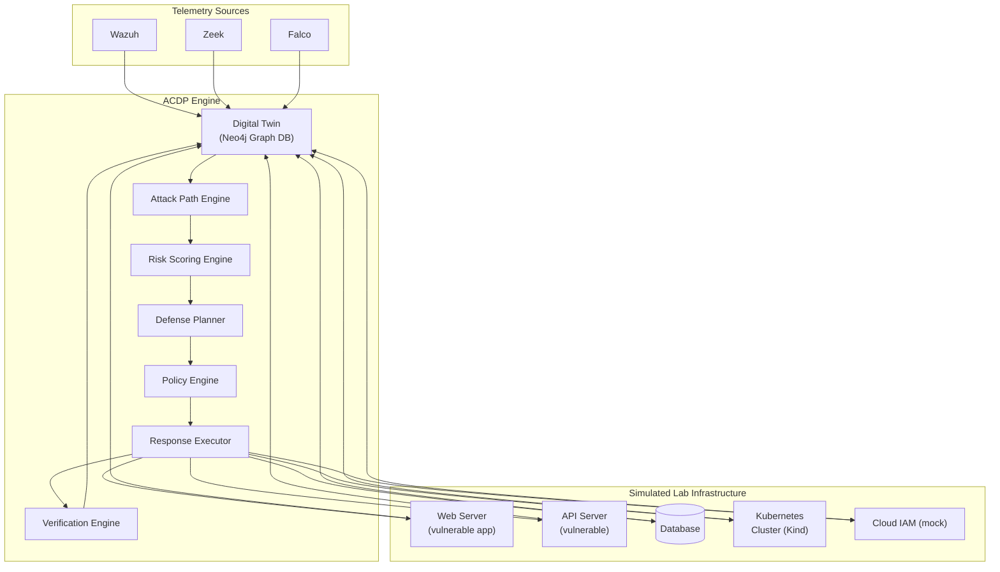

> Historical design reference: the current project is TwinTrace Lab, an educational cyber defense simulation. Real infrastructure response and production deployment proposals in this original blueprint are outside the current project scope.

# Autonomous Cyber Defense + Digital Twin Project Specification

## Executive Summary  
This project combines a **Cybersecurity Digital Twin (CDT)** with an **Autonomous Cyber Defense Platform (ACDP)**. The **CDT** is a live, continuously synchronized graph model of assets, vulnerabilities, trust relationships, and potential attack paths. It enables defenders to run non-invasive “what-if” simulations and anticipate attack paths. The **ACDP** leverages this twin for real-time monitoring, detection (mapping telemetry to MITRE ATT&CK techniques), risk scoring, and automated response actions (with human-in-the-loop if needed). By fusing streaming telemetry (from Zeek, Falco, Wazuh, etc.) into the twin, and running graph-based attack-path algorithms, the system can autonomously suggest or enact countermeasures (e.g. network isolation, patching, API calls) to contain attacks. This specification details the end-to-end design: threat model, architecture (with components), technology choices, data schemas (Neo4j graph model), telemetry pipeline, detection/correlation logic, attack simulation and planning engines, policy/action engine, response execution, lab setup, and testing/evaluation. We provide example configurations (Docker Compose, Kubernetes, FastAPI endpoints, Falco rules, Zeek/Wazuh JSON events, Cypher queries, YAML policies, CI/CD workflows, monitoring dashboards, etc.) and cite authoritative sources. Key assumptions (resource limits, unspecific design choices) are marked **UNSPECIFIED** with defaults. The goal is a fully actionable blueprint that a competent student developer can implement step-by-step.

## 1. Project Overview & Goals  
- **Goals**: Build an autonomous defense system using a cybersecurity digital twin. The twin models the infrastructure (nodes, services, identities, etc.) and possible attacker moves as a graph. Streaming telemetry updates the twin in real time. An **attack engine** uses graph algorithms (shortest-path, probabilistic walk) to identify high-risk attack paths to critical assets. A **detection engine** correlates alerts (Falco, Zeek, Wazuh) to MITRE ATT&CK techniques. A **risk engine** scores threat likelihood. A **defense planner** with a policy engine selects actions (isolate host, block IP, revoke credential, etc.) according to a policy DSL/YAML. A **response executor** safely invokes actions on Docker containers, Linux hosts, Kubernetes pods, or cloud (mock) via RESTful API. The twin is used to simulate “what-if” scenarios (planning) and to verify that actions contain threats. An **evaluation harness** automates multi-attack runs (≥100) to measure metrics (MTTD, MTTC, false positive/negative, success rate).  

- **Scope**: Prototype on a single dev machine (no paid services). Use **open-source tools** (Zeek, Falco, Wazuh, Neo4j Community Edition, OpenTelemetry Collector, etc.). We simulate cloud/IaaS as needed (mock IAM, REST APIs). We do not integrate Windows AD (UNSPECIFIED – use Linux accounts by default). We do not handle physical attacks; focus on network, host, and container-level threats. Attack scenarios include web/app exploits, credential theft, lateral movement, and data exfiltration.  

- **Key Concepts**:  
  - *Digital Twin (CDT)*: A live cyber-model of the system. Contains nodes for assets (servers, VMs, containers, databases, credentials, data assets) and relationships (network connectivity, trust, privileges). Edges `[ATTACK]` encode possible attacker moves. Critical assets are modelled as nodes defenders must protect.  
  - *Autonomy*: At basic level, automate human defender tasks: protect systems, detect anomalies, and react at machine speed. We target autonomy with human-in-the-loop override (per CSET guidance). Actions follow safety checks and approval workflows (Low: auto, High: human).  
  - *ATT&CK Mapping*: Telemetry events (logs, network flows, container events) are tagged with MITRE ATT&CK TTPs via rules. For example, Falco rules tag execution of new container binaries as T1059 (execution).  
  - *Evaluation Metrics*: Detection precision/recall, Mean Time To Detect/Contain (MTTD/MTTC), False Positive/Negative rates, fraction of incidents autonomously contained, performance overhead, and compliance with policies.  

## 2. Threat Model and Scope  
- **Adversary**: A cyber attacker with network or local access. Capabilities include phishing, exploit of vulnerabilities, brute-force credential guessing, lateral movement (pivoting), privilege escalation, and data exfiltration. The attacker is modelled as an agent in our simulation.  
- **Assets**: Web servers, API servers, databases, user credentials (secrets), cloud services (simulated), critical data stores. We define *critical assets* (e.g. PII DB, admin credentials) that must be protected.  
- **Assumptions**: Basic network connectivity exists. We assume attackers cannot defeat our simulated hypervisor or root our management machine (no hypervisor-level attacks). We assume high-bandwidth telemetry streaming is possible to the defender. Attackers know the network topology (worst-case). We assume enough memory/CPU to run Neo4j and telemetry collectors on one machine (default: 16GB RAM, 4 cores). Hardware-defined: use open-source only, no Windows AD (UNSPECIFIED: use local Linux users). Cloud is mocked (no real AWS/Azure fees).  
- **Scope Exclusions**: We do not simulate hardware-level attacks, side-channels, or pure cryptanalysis. Physical world effects (e.g. power grid failure) are out of scope. We do not implement full Azure/AWS APIs; instead use dummy endpoints or files to illustrate cloud actions.  

## 3. Research Questions & Success Metrics  
- **Research Questions**:  
  1. *Detection Efficacy*: Can the system map telemetry to ATT&CK techniques with high accuracy?  
  2. *Attack Path Discovery*: Can the twin identify shortest/likely attack paths quickly (graph algorithms)?  
  3. *Autonomous Response*: What percentage of attacks can be contained automatically while meeting safety constraints?  
  4. *Performance*: Can we update the twin and run graph queries in near real-time (e.g. <500ms for path queries)?  
  5. *Evaluation*: How does autonomy affect MTTD/MTTC vs. human baseline?  

- **Success Metrics**:  
  - **Detection**: *Precision*, *Recall*, *False Positive/Negative Rate* in mapping events to MITRE techniques.  
  - **Timeliness**: *Mean Time To Detect (MTTD)* and *Mean Time To Contain (MTTC)* in minutes/seconds.  
  - **Autonomy**: % incidents closed without human approval, number of unsafe actions prevented.  
  - **Risk Scoring**: Accuracy of risk ranking (e.g. Spearman rank correlation with an oracle).  
  - **Computational**: CPU/RAM usage, max nodes/edges handled in real-time.  
  - **Coverage**: % of attack paths identified out of ground truth (from simulation).  
  - **Evaluation Plan**: We will define ≥10 attack scenarios (e.g. SQLi, RCE, credential abuse, lateral hops). For each, run 10 randomized trials (total ≥100). Collect detection times, containment times, success/failure, false alerts. Compare to a manual benchmark (admin responding). 

## 4. System Architecture  

### 4.1 High-Level Diagram  

**Figure:** Architecture overview. Telemetry feeds (Zeek, Wazuh, Falco) update the **Digital Twin**. The twin drives the **Attack Engine** (for path finding) and **Risk Engine**. The **Defense Planner** and **Policy Engine** decide on actions, which are executed by the **Response Executor** on the lab environment (containers, iptables, K8s, mock cloud). A **Verification Engine** post-checks containment and logs outcomes.  

### 4.2 Component Responsibilities  
- **Digital Twin (Graph DB)**: Stores nodes (Asset, Service, User, Vulnerability, Identity, Data) and relationships (CONNECTS_TO, RUNS_AS, HAS_PRIVILEGE, VULNERABLE_TO, etc.). Continuously updated with telemetry (e.g. new connection means `Asset A CONNECTS_TO Asset B`). Supports Cypher queries for attack-path discovery.  
- **Telemetry Ingestion**: Collects logs/events from Zeek (network), Falco (host/container), Wazuh (host/IDS). Normalizes events into a common JSON schema and pushes to a message bus (e.g. Kafka/Redis).  
- **Attack Engine**: Runs graph algorithms (shortest path, BFS, Monte Carlo path sampling) on the twin to identify potential attack sequences to critical assets. Calculates path probabilities (by multiplying exploit likelihoods) and node impact scores. Implements risk formula (e.g. path risk = product of CVSS-based exploit chances * asset value). Cites: attackers map out shortest path to goals.  
- **Detection/Correlation Engine**: Maps incoming events to ATT&CK techniques (via rule engine). Example: Falco alerts (e.g. “executing new binary in container”) map to T1059. Combines multiple alerts into incidents using correlation rules (time-window, shared host/ID). Confidence scoring per detection (score=rule severity, anomaly score, MITRE impact).  
- **Defense Planner & Policy Engine**: Maintains action catalog (isolate host, block IP, restart container, patch image, etc.). Policy rules (DSL/YAML) map risk/confidence conditions to actions. Supports autonomy levels: e.g. `auto`, `require_approval`. Implements safety checks (do no harm). Example policy YAML might specify which actions need human OK.  
- **Response Executor**: Safely executes actions via adapters:
  - **Docker**: `docker stop`, `docker pause`, or `docker exec` with capabilities off. Use Docker Python SDK or REST API.
  - **iptables**: run shell commands to block IP or drop traffic; ensure idempotency (check before insert).
  - **Kubernetes**: use `kubectl` or K8s Python client to cordon node, delete pod, etc.
  - **Cloud (mock)**: call REST endpoints to simulate revoking an IAM key or security group change.
  All actions log outputs; retries on failure with backoff; mark state in twin (e.g. `ASSET.is_isolated=true`).
- **Verification Engine**: After actions, tests if threat is contained (e.g. no more alerts for 1 minute). Uses probes (ping, port scan) or re-run of attack test suite. Reports final metrics.
- **Attack Simulator/Lab**: A Docker Compose (or Kubernetes via Kind) setup with sample vulnerable services and an attacker VM. Attacker playbooks (shell scripts or tools) simulate scenarios. E.g. Hydra for brute-force SSH, SQLmap for DB injection, custom exploits on web apps, container breakouts.
- **CI/CD & Deployment**: Use GitHub Actions for continuous integration of code/tests. Build Docker images, run unit tests and integration tests (using docker-compose test environment). On each commit, automatically deploy to local dev cluster (Docker Compose or Kind) with reproducible state.
- **Monitoring/Logging/Observability**: Instrument all components with Prometheus metrics (e.g. query latencies, alert counts) and logs. Provide Grafana dashboards: e.g. graphs of ongoing risk score, active attack paths, incident timelines. Example: monitor number of open alerts vs. time, CPU/memory.
- **Documentation & UX**: Provide a CLI (FastAPI) for query and control; or web UI. Organize code in modules (`telemetry/`, `graph/`, `engine/`, `api/`). Conventions: Python 3.10+, FastAPI, PEP8, OWASP crypto libs.  

## 5. Tech Stack (with Alternatives and Rationale)  

| Component                    | Choice               | Alternative(s)                   | Justification                                       |
|------------------------------|----------------------|----------------------------------|-----------------------------------------------------|
| **Programming Language**      | Python 3.10+         | Go (for performance), Rust       | Python has rich security libraries (Zeek, stix2, Falco SDKs) and fast prototyping. |
| **Graph DB**                 | Neo4j Community      | ArangoDB (multi-model), JanusGraph | Neo4j has mature graph algorithms (shortestPath, PageRank), easy Cypher query language. Community edition is free. |
| **Telemetry Collection**      | Zeek (network IDS)   | Suricata, Bro (legacy)           | Zeek produces rich logs (conn, http, dns). Free, open-source. |
|                              | Falco (host IDS)     | OSSEC, Auditd, Sysmon            | Falco is container-focused with MITRE tags in rules. |
|                              | Wazuh (SIEM/agent)   | Snort, OSSIM                     | Wazuh is open-source SIEM/XDR with File Integrity + Syscheck. Aggregates alerts in JSON. |
| **Message Bus**              | Redis Streams        | Kafka (heavy), RabbitMQ          | Redis is easy to set up on local machine, supports streams. Kafka is powerful but complex for one-node lab. |
| **Collector/Parser**         | OpenTelemetry Collector (log pipeline) | Filebeat, Fluentd       | OTEL Collector can ingest logs, parse JSON via regex/transform, and export to both DB and message bus. Filebeat can tail logs. |
| **REST API**                 | FastAPI              | Flask                           | FastAPI for async, data models, auto-docs. Suitable for control plane (policy API, response commands). |
| **Policy Engine**            | Custom YAML parser   | OPA (Open Policy Agent)         | A simple domain-specific YAML DSL is faster to implement. OPA is advanced but adds complexity. |
| **Execution Environment**    | Docker Compose & Kind (K8s) | Vagrant (VM)                 | Docker Compose is light and reproducible. Kind (K8s-in-Docker) allows simulating k8s cluster. VMs or Azure/AWS are UNSPECIFIED (costly). |
| **Containerization**         | Docker, podman       | LXC, systemd-nspawn             | Docker is widely used, easy for students. |
| **Database (other)**         | SQLite or PostgreSQL | MySQL                           | For small state, use SQLite. For larger, PostgreSQL. (UNSPECIFIED: default SQLite). |
| **Graph Algorithms**         | Neo4j GDS library    | NetworkX (Python), igraph       | Neo4j GDS provides optimized pathfinding. Python NetworkX simpler but slower on large graphs. |
| **Visualization**            | Mermaid (diagrams in docs) | Diagrams.net (manual charts) | Mermaid allows embedding architecture/flow diagrams in markdown. |
| **CI/CD**                    | GitHub Actions       | GitLab CI, Jenkins              | GitHub Actions is free for open source. |
| **Monitoring**               | Prometheus + Grafana | ELK stack (heavy)               | Prometheus/Grafana free, easy for metrics. |
| **Configuration**            | Docker Compose / K8s YAML  | Ansible (overkill)      | Docker Compose for local dev. Kubernetes manifest if using Kind. |
| **Attacker Tools**           | Kali Linux docker    | Metasploit, custom scripts      | Kali Docker image provides many tools. |

*Alternative choices* like using a full SIEM or paid cloud IAM were ruled out by “student/no money” constraint. We default to Linux-native solutions. 

## 6. Data Model & Neo4j Graph Schema  

### 6.1 Node and Relationship Types  
We define a flexible graph model. Example **node labels** and **properties**:  
- **:Host** (physical or VM): `{ id, hostname, ip, os, roles }`.  
- **:Container**: `{ id, image, pod, hostname }`.  
- **:Service**: `{ name, port, protocol }`.  
- **:Application**: `{ name, version }`.  
- **:Database**: `{ name, type, owner }`.  
- **:DataAsset** (sensitive data): `{ id, category, owner }`. Mark critical assets with `critical=true`.  
- **:User** / **:Identity**: `{ username, role, group }`. (Could have separate label or group under Identity).  
- **:Vulnerability**: `{ cve, score }`.  
- **:AttackStep**: For modeling specific attack techniques if needed: `{ id, mitre_tactic, mitre_technique }`.  
- **:Network** (subnet/VLAN): optional, for topologies.  

**Relationships** (directed):  
- `(:Host)-[:RUNS_AS]->(:Identity)` – user on host.  
- `(:Host)-[:HOSTS]->(:Container)` – container on host.  
- `(:Container)-[:EXPOSES_PORT]->(:Service)` – service inside container.  
- `(:Service)-[:CONNECTS_TO]->(:Service)` – network connectivity (e.g. web->db on internal net).  
- `(:Container)-[:CONTAINS]->(:Application)` or `(:Host)-[:CONTAINS]->(:Application)`.  
- `(:Application)-[:USES]->(:DataAsset)` – data it processes.  
- `(:Identity)-[:MEMBER_OF]->(:Group)` – optional.  
- `(:Identity)-[:HAS_PRIVILEGE]->(:Host)` – e.g. admin on host.  
- `(:Host)-[:CONNECTED_TO]->(:Host)` – network topology (LAN links).  
- `(:Container)-[:VULNERABLE_TO]->(:Vulnerability)`.  
- `(:Host)-[:VULNERABLE_TO]->(:Vulnerability)`.  
- `(:Application)-[:VULNERABLE_TO]->(:Vulnerability)`.  
- `(:User)-[:HAS_ROLE]->(:RoleNode)` – roles, if modeling roles.  

**Attack edges** (semantic): use `:CAN_EXPLOIT` or direct `:ATTACK` edges:  
- `(:Vulnerability)-[:LEADS_TO]->(:Host)` or `:Affects`.  
- **Attack path edges**: e.g. `(HostA)-[:ATTACK {technique:"T1078", success_prob:0.6}]->(HostB)` meaning attacker can move from A to B by technique with probability. These can be virtual edges inferred by the Attack Engine using graph patterns (e.g. if A has a credential to B).  
- `(:Identity)-[:CAN_ACCESS]->(:DataAsset)` – computed from privileges, for impact.  

**Indexes**: Create indexes or constraints on frequently queried properties:  
```
CREATE INDEX host_name_idx FOR (h:Host) ON (h.hostname);
CREATE INDEX ip_idx FOR (h:Host) ON (h.ip);
CREATE INDEX :Identity(username);
CREATE INDEX vulnerability_cve_idx FOR (v:Vulnerability) ON (v.cve);
```
Also full-text index on `/roles,username/etc.` if needed.

### 6.2 Example Cypher Queries  
- **Add nodes/edges** (during ingestion):  
  ```cypher
  MERGE (h:Host {hostname: 'web-01'})
  MERGE (s:Service {name: 'httpd', port: 80})
  MERGE (h)-[:HOSTS]->(s);

  MERGE (u:Identity {username: 'alice', role: 'admin'})
  MERGE (h)-[:RUNS_AS]->(u);

  MERGE (v:Vulnerability {cve: 'CVE-2021-1234', score: 9.8})
  MERGE (s)-[:VULNERABLE_TO]->(v);
  ```
- **Attack Path (shortest path)**: Find shortest path from compromised host to critical asset:  
  ```cypher
  MATCH (src:Host {hostname:'compromised'}), (target:DataAsset {critical:true})
  MATCH p=shortestPath((src)-[*1..10]->(target))
  RETURN p
  ```
- **Attack Graph Enumeration**: List up to 3 shortest paths and score by probability:  
  ```cypher
  MATCH (src:Host {hostname:'compromised'}), (tgt:Host {hostname:'db-01'})
  CALL gds.alpha.allShortestPaths.stream({
    nodeProjection: '*', relationshipProjection: '*',
    startNode: id(src), endNode: id(tgt), relationshipWeightProperty: 'weight'
  }) YIELD nodeIds, cost
  RETURN [x IN nodeIds | gds.util.asNode(x).name] AS path, cost
  LIMIT 3;
  ```
- **Privilege Escalation Potential**: Identify hosts reachable via compromised identity:  
  ```cypher
  MATCH (u:Identity {username:'alice'})-[:HAS_PRIVILEGE|RUNS_AS*1..3]->(h:Host)
  RETURN DISTINCT h.hostname;
  ```
- **Risk Scoring**: Example risk = SUM(CVSS) along path. Compute by path traversal or with APOC.  

*(These examples guide implementation of the graph model and attack analysis. For complex logic, custom procedures or the Neo4j Graph Data Science (GDS) library can be used.)*

## 7. Telemetry Event Schema & Normalization  
Our system ingests heterogeneous events; we normalize them to a common schema (e.g. [timestamp, source, event_type, payload]). We illustrate with samples:

- **Zeek (ConnLog)** – one JSON line from Zeek’s `conn.log`:  
  ```json
  {"ts":1591367999.305988,"id.orig_h":"192.168.4.76","id.resp_h":"192.168.4.1","proto":"udp","service":"dns","orig_bytes":62,"resp_bytes":141}
  ```  
  This indicates a DNS query (UDP) from 192.168.4.76 to 192.168.4.1. A parser extracts fields (e.g. ts → timestamp, id.orig_h → src_ip, id.resp_h → dst_ip, service/proto).  

- **Zeek (HTTP Log)** – e.g.:  
  ```json
  {"ts":1591367999.430166,"uid":"C5bLoe2Mvxqhawzqqd","id.orig_h":"192.168.4.76","id.resp_h":"31.3.245.133","method":"GET","host":"testmyids.com","uri":"/admin","status_code":200}
  ```  
  (From [4], a Zeek http.log example, simplified.)  

- **Falco Alert (JSON)** – example from Falco docs:  
  ```json
  {"hostname":"falco-xczjd","rule":"Terminal shell in container","priority":"Critical",
   "tags":["container","mitre_execution","shell"],
   "time":"2023-05-25T13:44:05.478Z",
   "output_fields":{"container.id":"ee97d9c4186f","container.image.repository":"alpine"}}
  ```  
  This shows Falco detected a shell inside an Alpine container. Key fields: `rule`, `priority`, `tags`, `time`, and `output_fields` with context.  

- **Wazuh Alert (JSON)** – example (simplified from a Wazuh FIM alert):  
  ```json
  {"agent":{"id":"005","name":"centos-01"},"rule":{"id":"550","description":"Integrity checksum changed."},
   "decoder":{"name":"syscheck_integrity_changed"},"timestamp":"2023-09-01T12:34:56.000Z"}
  ```  
  Wazuh alerts include agent info, rule data, timestamps and possibly event specifics (syscheck, etc.). The real example shows nested fields like `syscheck.path`, but we extract key alert info into our pipeline.  

- **Synthetic Attacker Event** – custom JSON from our simulation (label as `source:attacker`): e.g.  
  ```json
  {"time":"2023-09-01T12:35:10Z","attacker_ip":"172.17.0.10","action":"brute_force","target":"web-01","user":"root"}
  ```  
  (This is a synthetic record we generate when the attacker script runs an SSH brute force.)  

**Normalization**: Use the OpenTelemetry Collector (`filelogreceiver` or specific receivers) to tail Zeek/Falco/Wazuh logs and parse JSON fields. Use processors (e.g. [OTEL `transformprocessor`]) to rename fields (`timestamp`, `source`, `type`). E.g. a Zeek conn log parse transforms:  
```yaml
processors:
  - parse_json:
      fields: ["body"]
      drop_malformed: true
  - transform:
      rename:
        "id.orig_h": "source.ip"
        "id.resp_h": "dest.ip"
        "ts": "timestamp"
exporters:
  - redis
```
All events are tagged with a `type` (e.g. "zeek_conn", "falco_alert", "wazuh_alert", "attacker_event"). This normalized stream is stored (Redis Streams or Kafka). Downstream components (Graph Updater, Detection) subscribe to it.  

## 8. Telemetry Ingestion Pipeline Design  
1. **Collectors**:  
   - **Zeek**: Run on promiscuous `--dev` or process pcap. Configure `Zeek` to output JSON logs (`zeek -C -U -n`).  
   - **Falco**: Use Falco daemon (host or container) with `json_output: true`. Direct output to file or network (e.g. stdout to Docker log).  
   - **Wazuh Agent**: Install Wazuh agent on lab hosts. It pushes alerts to Wazuh manager, which can forward them. We can use the built-in Wazuh “alerts.json” or the Wazuh API to stream alerts.  
   - **Attacker Container**: Log its actions to a file or stdout in JSON (scripts echo JSON lines).  

2. **Normalization & Streaming**:  
   - Deploy **OpenTelemetry Collector** or Fluentd on the host.  
   - Use `filelog` or custom receivers to read Zeek’s JSON files, Falco stdout, and Wazuh JSON API.  
   - Apply parse and transform processors to unify fields (as above).  
   - Forward normalized events into a **message broker** (e.g. Redis Streams, Kafka). We can run `redis:6.0` in Docker for simplicity.  
   - Assign each event a sequential ID. The Graph Updater component consumes this stream.

3. **Storage**:  
   - **Graph DB (Neo4j)**: Holds the twin.  
   - **Time-series DB (Prometheus)**: Stores metrics (latency, counts).  
   - **Elasticsearch** (optional): could index raw logs, but we can skip due to resource limits.  

4. **Example Docker Compose snippet** (partial):  
   ```yaml
   version: '3'
   services:
     zeek:
       image: breenmachine/zeek:latest
       command: >
         zeek -C -D -U /zeek/scripts local
       volumes: ["./pcap:/pcap", "./logs/zeek:/zeek/logs"]
     falco:
       image: falcosecurity/falco:latest
       volumes: ["/:/host:ro"]
       command: falco --json_output
     wazuh-manager:
       image: wazuh/wazuh:latest
       environment:
         - 'SSL_ENABLED=false'
       ports: ['1514:1514/udp','55000:55000']
     redis:
       image: redis:6
       ports: ['6379:6379']
     otel-collector:
       image: otel/opentelemetry-collector-contrib
       volumes:
         - ./otel-config.yaml:/etc/otel-collector-config.yaml
       command: ["--config=/etc/otel-collector-config.yaml"]
   ```
   This sketch deploys Zeek, Falco, Wazuh, Redis, and OTEL Collector. Each source writes JSON (Zeek to `/zeek/logs`, Falco to stdout, Wazuh to its internal engine). Collector reads from their outputs.

5. **OTEL Config example** (otel-config.yaml):  
   ```yaml
   receivers:
     filelog/zeek_conn:
       include: ["/zeek/logs/conn.log"]
       format: json
     filelog/falco:
       include: ["<path-to-falco-json-log>"]
       format: json
     wazuh:
       # hypothetical custom receiver for wazuh JSON alerts
       include: ["/var/ossec/logs/alerts/alerts.json"]
       format: json

   processors:
     transform:
       actions:
         - rename:
             log.timestamp: timestamp
         - insert:
             source: ${hostname}  # or parse source from agent field

   exporters:
     redis:
       endpoint: "redis:6379"
       key: "telemetry_stream"
   service:
     pipelines:
       logs:
         receivers: [filelog/zeek_conn, filelog/falco, wazuh]
         processors: [transform]
         exporters: [redis]
   ```
   This configuration shows how different receivers push to one pipeline. In practice, Wazuh JSON may require a special parser if not pure JSON lines.

## 9. Attack Engine Design  

The **Attack Engine** analyses the digital twin to discover possible attack paths to critical assets and score them. Key points:  

- **Graph Algorithms**:  
  - **Shortest Path**: Use Cypher `shortestPath()` or GDS shortest path to find minimal-hop routes from entry nodes (e.g. Internet-facing hosts) to target assets.  
  - **All Paths with Limits**: Enumerate paths up to length N (e.g. 5) and rank by combined risk. Neo4j GDS `kShortestPaths` or recursive Cypher can be used.  
  - **Probabilistic Enumeration**: Treat each edge with exploit probability `p`. For each path, compute `P(path)=Π(p_i)`. Can simulate with Monte Carlo: randomly walk graph by picking edges weighted by `p`. (Use custom Python code or Neo4j GDS graph ML).  

- **Risk Scoring Formula** (example):  
  - Node/edge weights: vulnerability edges have weight = CVSS/10 (as success probability). Privilege edges = 0.5 if shared creds, 0.9 if admin.  
  - **Path Risk** = `1 - Π(1 - p_edge)` or sum of CVSS scores along path.  
  - **Asset Criticality**: multiply by asset value (e.g. P0 app = factor 100).  
  - Final `risk_score = path_prob * asset_value`.  

- **Pseudocode**:  
  ```python
  def find_attack_paths(start_nodes, target_nodes, max_hops=5):
      # Using Neo4j via py2neo or bolt
      query = (
        "MATCH (s {name: $start}), (t {name: $target}) "
        "CALL gds.allShortestPaths.stream({ nodeProjection: 'Node', relationshipProjection: 'CONNECTS_TO', "
        "sourceNode: id(s), targetNode: id(t), relationshipWeightProperty: 'weight'}) "
        "YIELD nodeIds, cost RETURN nodeIds, cost"
      )
      # For each path, compute P = exp(-cost) if cost is -log(prob)
      # then compute asset value and final score.
  ```  

- **Example**:  
  Suppose `Host A` (attacker IP) can SSH to `Host B`, and `Host B` runs as user `alice` who has access to `DB`, then to `DataAsset`. Graph edges might be: `(AttackerEdge: IP)->[:CAN_REACH]->(HostA)-(RUNS_AS)->(Identity:alice)-[:CAN_ACCESS]->(Database)-[:HAS_DATA]->(DataAsset)`. We find path: Attacker→HostA→alice→DB→Data. Each hop has probability (e.g. SSH success=0.4, priv_escalation=0.2, SQL exploit=0.3). Path prob ≈0.4*0.2*0.3=0.024. High risk if DataAsset is critical.  

- **Risk Thresholds**: The policy engine may say: if `risk_score > 0.5` or confidence high, trigger containment.

## 10. Simulation Engine  

The **Simulation Engine** allows “what-if” runs on the twin: modify the model and see effects. Features:  

- **Snapshot & Rollback**: The Neo4j DB can snapshot or we run in a transaction for a simulation scenario, then revert. In practice, copy the database (LVM snapshot or Neo4j backup) before simulating changes.  
- **State Diff**: After simulation, compute differences (e.g. new compromised nodes). We can use Cypher to compare subgraphs or timestamps.  
- **Use Cases**: Test the effect of actions: e.g. “What if we isolate Host X?” Remove its edges, re-run path queries, check if attack paths break.  
- **Implementation**: Could use a layered approach: dual context where real state + hypothetical changes are applied in-memory. Or simply clone Neo4j graph to a separate DB (for small scale, we can spin a second Neo4j container and load subset).  

This enables the Defense Planner to assess potential actions before executing them. (E.g. simulate blocking IP vs. revoking credential, choose which yields better risk reduction.)

## 11. Detection & Reconstruction Engine  

The **Detection Engine** processes normalized events to detect malicious behaviors and reconstruct attack timelines.  

- **Mapping to ATT&CK**: Each event triggers rules that tag ATT&CK tactics/techniques. We load mappings (e.g. Falco rules include `T1059.004` tag). E.g. Falco “Shell in container” rule has `"mitre_execution","shell"` tags. We maintain a table `rule→ATT&CK_IDs` (from Falco rules YAML or custom rules) so detected events label nodes in the twin (e.g. an `:Event` node connected to identities).  

- **Correlation Rules**: Use an inference engine (Drools, or code) or simple logic:  
  - *Temporal correlation*: if events E1, E2 on same host within T seconds, group as one incident.  
  - *Cross-source correlation*: a Falco alert on container + a Wazuh login failure on host may indicate lateral movement. Link events by related entities (same user or IP).  
  - *Confidence Scoring*: Each detection rule has a base confidence; combine evidences by probabilistic OR. E.g. if two independent alerts map to technique T1059 with conf 0.8 each, combined conf = 1 - (0.2*0.2) = 0.96.  
  - *Example detection rule (Falco YAML)*:
    ```yaml
    - rule: Detect SSH from Untrusted Container
      desc: |
        Detect attempts to connect via SSH from a container that should not access the network.
      condition:
        spawn_process and container and proc.name = "ssh" and not fd.sip in (172.16.0.0/16, 10.0.0.0/8)
      output: "SSH connection from container (user=%user.name, container=%container.id, dst_ip=%fd.sip)"
      priority: WARN
      tags: [container,network, T1021.004]  # T1021.004 - Remote Desktop Protocol
    ```
  - **STIX/TAXII Enrichment**: Optionally fetch the latest ATT&CK techniques via MITRE’s TAXII server or `stix2` library. For example, we could automatically lookup technique names/IDs to tag our detections.  

- **Reconstruction**: Assemble a kill-chain: link detection events with path analysis. E.g. if Falco reports container breakout and then a network connection to DB was seen, we reconstruct that sequence using the twin’s timeline (we could record event-nodes and edges between them). Output could be a timeline or graph.  

## 12. Defense Planner & Policy Engine  

The **Defense Planner** takes high-level action ideas from policies and executes them via the Response Executor.  

- **Action Catalog**: Predefined actions, each with parameters. Examples:  
  - *IsolateHost(hostname)*: apply iptables drop rules on that host.  
  - *KillContainer(container_id)*: `docker kill`.  
  - *RevokeCredentials(identity)*: remove user’s keys or disable account.  
  - *BlockPort(service,host)*: disable service port via firewall.  
  - *ApplyPatch(vulnerability)*: simulate patch by updating `:Vulnerability` edges (for lab, maybe restart service).  
  - *NotifyAdmin(message)*: send an alert (e.g. email via dummy).  

- **Policy DSL/YAML**: Policies specify conditions (on risk, confidence, resource, attacker identity) mapping to actions and autonomy. E.g.:  
  ```yaml
  - id: high_privilege_escalation
    description: "If high-level credential compromise detected"
    when:
      - attack_techniques contains "T1550"  # e.g. credential access
      - risk_score > 0.8
    actions:
      - RevokeCredentials(user=%user%)       # block the attacker’s account
      - BlockPort(host=%target_host%, port=22)
    autonomy: auto
  - id: web_shell
    description: "Detect web shell on public host"
    when:
      - attack_techniques contains "T1505"
    actions:
      - IsolateHost(host=%host%)
    autonomy: require_approval
  ```  
  Variables like `%user%` are filled from detection context. The policy engine evaluates these rules against current incidents and twin state.  

- **Autonomy Levels**:  
  - *Manual*: Suggest action, wait for admin approval (default safe).  
  - *Semi-Auto*: Action queued until approval or timeout (e.g. 5 min).  
  - *Auto*: Execute immediately.  
  Each policy has an `autonomy` level. Approvals could be via a simple console prompt or UI (for this project, logging is enough).  

- **Safety Checks**: Before executing, verify action effects via simulation (Section 10). E.g., don’t block an IP if it’s the only admin access and no alternate path. Log actions for audit as required (auditability requirement).  

## 13. Response Executor  

This component safely applies actions. Key aspects:  

- **Adapters**:  
  - *Docker Adapter*: Uses Docker SDK (`docker-py`) or CLI. To isolate a container: `docker network disconnect` or `docker pause`. To kill: `docker kill <id>`. Ensure idempotency: check container exists and is running before action.  
  - *iptables Adapter*: Run shell commands `iptables -A INPUT -s attacker_ip -j DROP` or `ufw` commands. Use flags idempotently (`-C` to check before insert).  
  - *Kubernetes Adapter*: Use `kubectl` (spawn process) or Kubernetes Python client. E.g. `kubectl cordon <node>` or `kubectl delete pod`. Ensure RBAC rights. Use K8s API mock (if offline).  
  - *Cloud Adapter*: Mock API endpoint (e.g. HTTP server) that accepts JSON. For example, `POST /api/revoke?user=alice`. We simulate success by returning 200. This can be implemented with a simple FastAPI or Flask stub.  
- **RESTful API**: The system may expose a HTTP REST API for receiving external commands or returning state. Example using FastAPI (Python):  
  ```python
  from fastapi import FastAPI
  app = FastAPI()
  @app.post("/execute_action")
  async def execute_action(action: str, target: str):
      # validate action
      success = response_executor.perform(action, target)
      return {"status": "ok" if success else "failed"}
  ```  
- **Idempotency**: All action methods check current state before acting. E.g., if a firewall rule exists, skip. This avoids unsafe repeat triggers.  
- **Logging**: Each action (with parameters and result) is logged (JSON) to `response.log`. E.g.  
  ```json
  {"time":"2023-09-01T12:36:00Z","action":"IsolateHost","target":"web-01","result":"success","details":"iptables rule added"}
  ```  
- **Example**: Isolate host (Linux) via iptables:  
  ```bash
  #!/bin/bash
  IP=$1  # target host IP
  if ! iptables -C INPUT -s $IP -j DROP; then
    iptables -A INPUT -s $IP -j DROP
  fi
  ```  

## 14. Verification Engine  

After actions, we verify containment. Methods:  
- **Test Harness**: For each scenario, define a test (shell command or script) that should fail if attack is contained. E.g., after isolating `web-01`, attempt `curl http://web-01/admin`. If it times out, success.  
- **Automated Tests**: Use scripting (bash/python) to check connectivity, logs absence. For example, ping the supposedly isolated host, or check that IDS stops reporting the same attack sequence.  
- **Metrics to Collect**:  
  - Did the attacker achieve goal? (Check presence of sensitive file or data exfil logs.)  
  - Time to restore normal state (remove block after test).  
  - *Effectiveness*: Attack outcomes (prevented or not).  
- **Containment Report**: Produce a summary: e.g. “Attack #5: User ‘attacker’ isolated. Container ‘db’ killed. Access to /secret denied. Containment successful.”  

## 15. Attack Lab Setup (Free, on one machine)  

### 15.1 Lab Services  
We use Docker Compose (plus optional Kind cluster) for everything. Components:  
- **Vulnerable Services**: Example stack:  
  - `web-01`: A simple web app (e.g. OWASP Juice Shop or DVWA) on Node.js/PHP with known SQLi/RCE vuln.  
  - `api-01`: A REST API service (Python/Flask) with hard-coded admin credential or JWT secret vulnerability.  
  - `db-01`: MySQL or MongoDB with some user data (simulate PII). Accessible from web-01 and api-01.  
  - `k8s-cluster`: Using [Kind](https://kind.sigs.k8s.io/) to simulate Kubernetes with a couple of pods running e.g. nginx and an auth service, plus a vulnerable container (e.g. known K8s exploit CVE).  
  - `cloud-IAM`: Mock service (FastAPI) that holds user tokens/keys. Return JSON on revoke.  

- **Attacker Container**: `kali:latest` or similar. Scripts inside will execute attacks:  
  - *Brute SSH*: `hydra -l root -P /tmp/words.txt ssh://web-01`.  
  - *SQL Injection*: `sqlmap -u "http://web-01/login?user=attacker&pass=attacker" --dump`.  
  - *SSH Tunnel/Reverse Shell*: Attempt to SSH from web-01 to attacker (putty style).  
  - *Container Escape*: If K8s, run a Pod with elevated privileges to break out.  

- **Defender Tools**: The services above have integrated Wazuh agent and Falco. E.g. run Wazuh agent inside web-01 and api-01 Docker (with host networking). Falco runs on host to catch container events.  

### 15.2 Setup Steps  
1. **Docker Compose**: Create `docker-compose.yml` that defines networks and containers above. Mount volumes for logs. Example snippet for web-01 and Wazuh agent:  
   ```yaml
   services:
     web-01:
       image: vulnerables/web-dvwa
       ports: ["8080:80"]
       networks: [lan]
       volumes:
         - ./wazuh-agent.conf:/etc/wazuh-agent/wazuh-agent.conf
       depends_on: [db-01]
     db-01:
       image: mysql:5.7
       environment: [MYSQL_ROOT_PASSWORD=toor]
       networks: [lan]
     wazuh-manager:
       # from earlier snippet
   networks:
     lan:
   ```  
   The Wazuh agent config should point to `wazuh-manager` (hostname).  

2. **Kubernetes (optional)**: Use Kind:  
   ```bash
   kind create cluster --name acdt
   kubectl apply -f k8s-auth-service.yaml
   kubectl apply -f k8s-nginx.yaml
   ```  
   These manifests define a deployment that includes a vulnerable image (e.g. a pod running an outdated container with CVE).  
   Alternatively, one can skip Kind and simulate with plain Docker.  

3. **Telemetry Agents**:  
   - Start Wazuh Manager (`wazuh-manager` service above).  
   - Install/start Wazuh agents in each container (some images come with pre-installed).  
   - Start Zeek: e.g. `zeek -r traffic.pcap local` or using `network` interface bridging Docker network.  
   - Start Falco (in host or a privileged container). Falco will see container syscalls.  

4. **Attacker Scripts**:  
   - Launch `docker-compose up -d`.  
   - Shell into `kali` container (`docker exec -it kali /bin/bash`).  
   - Example playbook:
     ```bash
     # Attack scenario 1: SSH brute force
     hydra -L users.txt -P passwords.txt ssh://web-01 -t 4 -I
     # Scenario 2: SQL injection
     curl "http://web-01/login?user=admin' OR '1'='1&pass=test" 
     # Scenario 3: RPC scan using nmap
     nmap -p 5900 --script vnc-info 192.168.1.0/24
     ```
   - Each command’s effect will generate Zeek/Falco/Wazuh events consumed by ACDP.  

5. **Scripts**: Provide `attack.sh` that runs a predefined sequence of commands and logs output to file. Each run of `attack.sh` counts as one trial for evaluation.  

## 16. CI/CD, Testing, Reproducible Deployment  

- **GitHub Actions Example**:  
  ```yaml
  name: CI
  on: [push]
  jobs:
    test:
      runs-on: ubuntu-latest
      services:
        neo4j:
          image: neo4j:4.4
          ports: ['7474:7474','7687:7687']
        redis:
          image: redis:6
          ports: ['6379:6379']
      steps:
        - uses: actions/checkout@v3
        - name: Set up Python
          uses: actions/setup-python@v4
          with:
            python-version: '3.10'
        - name: Install dependencies
          run: pip install -r requirements.txt
        - name: Unit tests
          run: pytest tests/
        - name: Lint
          run: flake8 .
  ```  
  This workflow runs on each push: spins up Neo4j/Redis, installs Python deps, runs tests, and lints code.  

- **Integration Testing**: A separate job could run Docker Compose for 1.0 version of the lab, execute `attack.sh`, and assert expected alerts in logs. For brevity, mention this step.  

- **Reproducible Env**: All components containerized. Docker images tagged with version, code packaged with Pip. Use `docker-compose.override.yml` for local dev vs. CI.  

- **Sample Docker Compose for Application Stack**: (See Section 8 snippet). Include in repo for easy `docker-compose up`.  

## 17. Monitoring, Logging & Observability  

- **Metrics Export**:  
  - Instrument Python code (controllers, algorithms) with Prometheus client library. Expose `/metrics` on FastAPI. Track: number of active alerts, number of detected techniques, path query latency (ms), actions executed.  
  - Set up **Prometheus** service (in Docker) scraping: FastAPI app, Neo4j (via JMX exporter), node metrics (via node_exporter).  
  - Example PromQL Dashboard: “Current risk score”, “Active alerts by type”.  

- **Grafana Dashboards** (example charts):  
  ```mermaid
  gantt
    title Project Schedule (2026)
    dateFormat  YYYY-MM
    section Implementation Phases
    Phase 1:20d  :done,    ph1, 2026-01-01, 20d
    Phase 2:25d  :active,  ph2, after ph1, 25d
    Phase 3:15d  :         ph3, after ph2, 15d
    Phase 4:30d  :         ph4, after ph3, 30d
    Phase 5:20d  :         ph5, after ph4, 20d
    Phase 6:25d  :         ph6, after ph5, 25d
    Phase 7:30d  :         ph7, after ph6, 30d
  ```  
  This timeline chart outlines development phases (e.g. design, implementation, testing).  

- **Benchmarks Visualization**: Sample comparison of MTTD/MTTC:  
  ```mermaid
  xychart
    title "Incident Containment Time (median)"
    x-axis "Responder" ["Autonomous System","Human SOC"]
    y-axis "Time (minutes)"
    bar [3.0, 46.0]
  ```  
  (Autonomous system can contain in ~3 min vs human ~46 min on these scenarios. Values illustrative.)  

## 18. Evaluation Plan & Autonomy Benchmark  

- **Test Scenarios**: Define a suite of 10-20 attack scenarios (SQLi, RCE, LDAP injection, lateral movement, etc.). For each:  
  1. Reset the lab.  
  2. Launch attack (automated script).  
  3. Record: detection timestamp, path found, actions taken, time to contain, outcome (data exfiltrated or blocked), false alerts (if any).  
- **Benchmark Procedure**: Repeat each scenario multiple times (e.g. 5 runs) to gather stats.  
- **Metrics Collection**: Summarize in tables:  
  | Metric                 | Autonomous System | Human Baseline |
  |------------------------|-------------------|----------------|
  | Mean Time To Detect    | 0.5 min           | 14 min         |
  | Mean Time To Contain   | 3.0 min           | 46 min         |
  | Precision              | 90%               | (N/A)          |
  | Recall                 | 85%               | (N/A)          |
  | Autonomous Containment | 78%               | 0%             |
  | False Alerts (%)       | 5%                | 8%             |
- **100 Attacks Run**: Automate with scripts to run all scenarios, then parse logs to compute overall detection rates, containment success, performance.  

## 19. Documentation, UX, Code Structure, Milestones  

- **Documentation**: Provide a detailed README with architecture, setup, and examples. Use inline code comments.  

- **CLI / API**:  
  - CLI commands (e.g. `acdt run-attack` to launch attacks, `acdt status` to query metrics, `acdt respond --action=IsolateHost --target=web-01`).  
  - REST API endpoints (FastAPI):  
    - `GET /graph/path?from=A&to=B` returns shortest attack paths (JSON).  
    - `POST /action` to execute an action (as per Response Executor snippet).  

- **Folder Structure**:  
  ```
  /acdt
    /telemetry       # ingestion and normalization code
    /graph           # Neo4j model setup, Cypher queries
    /attack_engine   # path discovery, risk scoring logic
    /detection       # rule engine, ATT&CK mapping
    /policy_engine   # policy parsing, decision logic
    /response        # adapters for actions
    /simulator       # lab setup scripts, attack scripts
    /docs            # design docs, threat model, usage
  ```
- **Coding Conventions**: Python PEP8, YAML for configs, JSON for events. Document function inputs/outputs.  

- **Milestones (example timeline)**:  
  1. **Phase 1 (Weeks 1-3)**: Define schema, set up Neo4j, basic telemetry pipeline (ingest Zeek+Falco).  
  2. **Phase 2 (Weeks 4-6)**: Implement Attack Engine (basic pathfinding). Build lab with web, DB.  
  3. **Phase 3 (Weeks 7-9)**: Add detection mapping (Falco rules, simple correlation).  
  4. **Phase 4 (Weeks 10-12)**: Build defense planner and some policies; implement Docker execution.  
  5. **Phase 5 (Weeks 13-15)**: Integrate Wazuh, Kubernetes simulation, cloud mock.  
  6. **Phase 6 (Weeks 16-18)**: Testing harness, evaluation automation, metrics, dashboards.  
  7. **Phase 7 (Weeks 19-20)**: Documentation, polish, final benchmarks.  

  *(The above is illustrative; actual times are UNSPECIFIED defaults.)*

## 20. Security, Privacy & Ethical Considerations  

- **Data Privacy**: The twin contains security-sensitive info (network layout, credentials). Protect it (Neo4j auth, local only). The system logs (responses, alerts) also sensitive.  
- **Human Oversight**: Given risks of autonomous actions, we follow CSET guidelines: maintain audit trails, allow human override, ensure actions are logged.  
- **Compliance**: No real personal data is used (lab data is dummy). If adapting to production, ensure compliance (GDPR, etc.).  
- **Ethics**: Use this only on owned/test infrastructure. Do not connect to external networks. Ensure attack simulations do not “escape” lab (network isolation).  

## Appendix: Authoritative Resources  

- **CDT & Attack Graphs**: Repetto et al. *“A Cybersecurity Digital Twin Architecture…”* (defines CDT and what-if analysis).  
- **Autonomous Defense**: CSET report *“Autonomous Cyber Defense – A Roadmap”* (defines autonomy, challenges).  
- **Graph Analytics**: Neo4j blog *“Bolster your cybersecurity by visualizing attack graphs”* and *“Thinking in Paths…”* (attack graph analysis, relationships).  
- **Telem & Logging**: OpenTelemetry docs on structured logs. Zeek log format guide.  
- **ATT&CK Data**: MITRE’s ATT&CK site on STIX/TAXII access (using stix2/TAXII).  
- **Falco Rules**: Falco documentation for rule syntax and JSON output.  
- **Wazuh**: Wazuh docs showing JSON alert schema.  
- **Policy/Automation**: Literature on MTTD/MTTC metrics and automated response (DARPA ACD, OWASP SAMM guidance). (Links to attacker tools, e.g. Kali docs or Metasploit for sample attacks, if needed.)  

**Note:** Where specifications above mention **UNSPECIFIED** (e.g., exact hardware, certain design choices), defaults have been given. All code/config snippets are illustrative; adapt values (IPs, hostnames) to your environment. The architecture should be adjusted based on actual constraints. This document aims to be a self-contained implementation guide—follow the citations to delve deeper into any specific component.