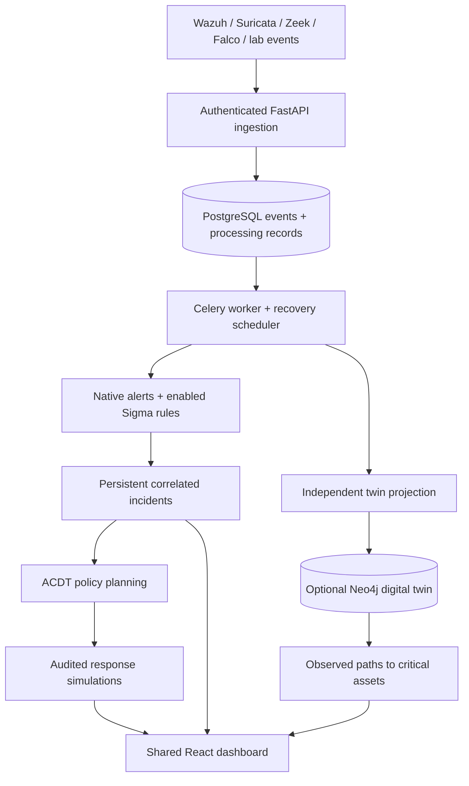

# Project comparison and merge

The combined project is now **TwinTrace Lab**, an educational cyber defense
simulation and portfolio project. The comparison below records its source history.
Current features and interview demonstration are described in [the portfolio guide](portfolio.md).

## Which project was more advanced?

| Area | OpenXDR before merge | ACDT before merge | Assessment |
| --- | --- | --- | --- |
| Usable application | React dashboard, login, events, incident assignment and notes | Small control-plane API; no dashboard | OpenXDR was further implemented |
| Persistence | PostgreSQL events, hosts, alerts and incidents | Neo4j query/update helpers; in-memory incident correlator | OpenXDR had stronger analyst workflow persistence |
| Telemetry | Wazuh, Suricata and Zeek parsers | Zeek, Wazuh, Falco and simulation normalizers | Complementary; both had gaps |
| Digital twin and attack paths | No graph layer | Neo4j schema, graph client and path queries | ACDT had the more advanced graph design |
| Policy and response | Analyst triage; no containment adapters | YAML policy engine and adapter skeletons | ACDT had broader scope; adapters only logged intent |
| Tests and CI | No application tests found | 13 passing unit tests and a CI workflow | ACDT had the stronger starting test foundation |
| Production maturity | Detection, delivery, settings and deployment defects | Disconnected prototype components and unauthenticated control plane | Neither was production ready |

OpenXDR is the application base; ACDT contributes analysis and defense modules.
This assessment is based on executable code and tests, rather than the breadth of
the two project blueprints.

## Unified architecture

The original ACDT source folder is unchanged (source commit `9d32679`). Its reusable package was imported
under `backend/acdt`, and its research document is retained as
`docs/acdt-research.md`. Its vulnerable lab remains opt-in under `lab/acdt`.
The original unprotected `/action` API is not exposed by the merged application.
The legacy `acdt.api.main:app` entry point serves the same authenticated API as
`app.main:app`.

The database incident correlator remains authoritative; ACDT's in-memory correlator
is retained as a library and tested without creating a second incident system.
Similarly, HTTP ingestion is the deployment entry point, while ACDT's Redis Stream
helpers remain reusable library functions rather than a second, disconnected daemon.

## Integration and corrections

- One event schema and ingestion endpoint support all five sources.
- Matching unambiguous hostnames reuse existing asset IDs across endpoint sensors.
  Raw source IDs are still preserved in the original payload.
- Upstream Wazuh, Suricata and Falco alerts are preserved even without a Sigma match.
- UTC timestamp parsing, Wazuh ATT&CK IDs and process field mappings are corrected.
- Rule evaluation respects log sources, boolean exclusions, wildcard selections,
  `contains|all`, null tests and CIDR checks. Unsupported syntax fails closed.
  The curated collection is enabled by default; the full bundled rule archive is
  retained for deliberate enablement and testing.
- Event and processing intent commit together. Row locking and completed-job checks
  prevent duplicate task deliveries from duplicating alerts. This does not deduplicate
  repeated submissions of the same upstream event as separate HTTP requests.
- Worker failures propagate and have persistent retry state. Twin failures do not
  roll back completed detection work. Notifications occur after incident commit.
- Shared encrypted integration settings and rule versions reach separate workers.
- Incident planning, simulation and history use authenticated endpoints and database
  audit records. Administrative operations enforce the configured admin identity.
- No-op response adapters report `simulated`. A verifier with no probes cannot claim
  containment. Evaluation metrics include legitimate zero-duration observations.
- Dashboard counts come from server aggregates. The UI reports API/database reachability
  and processing failures instead of a hardcoded Healthy label.
- Existing analyst workflows remain available, including nullable assignment updates.
- The merged deployment includes migrations, a recovery scheduler, a locked backend
  dependency set, a static frontend server, local-only application ports and private
  database/broker services. The Compose project name was left unchanged to preserve
  the existing volume namespace.

## Verification scope

The automated suite covers original ACDT behavior, ingestion through stored alerts
and incidents, policy planning through simulation history, authorization, settings
sharing, detection regressions, task failure/retry, graph projection boundaries,
application startup and non-destructive adoption of existing database tables.

SQLite tests and recording graph doubles do not validate PostgreSQL advisory locks,
Celery delivery under process crashes, Neo4j Cypher execution or container networking.
Run the Compose stack and exercise those services before deployment. The original
ACDT data directory and any separately running databases are not migrated by this
source-code merge.

## Completed simulation portfolio workflow (v0.3)

The merged app now includes seeded scenario replay, run-specific event/alert links,
independent fixture truth, TP/FP/FN/TN evaluation, exact-ID ATT&CK coverage, recorded
flow animation, local topology and simulated-state assertions, and HTML/JSON/CSV
reports. Seven fixtures include benign and deliberately missed/noisy cases.
`0002_experiments` adds run/evidence/trace tables without replacing prior records.

An Interview guide provides six visual chapters, a full architecture figure, an
explicitly illustrative lab photo and a timed demonstration script. The Project
notebook now lists implemented features and links to the working scenario runner.

The default twin uses stored connectivity without requiring Neo4j. Neo4j remains
an optional projection. Real response adapters and production operations remain
outside the simulation scope; model verification always records real containment
as false. Larger datasets, comparative rule experiments and optional live Neo4j
integration checks remain possible extensions.

## Detection experiments (v0.4)

The merged runtime now stores immutable detection configurations, pins exact rule
bodies and native-source thresholds in new run snapshots, and compares A/B replay
results. Comparison checks fixture compatibility and preserves unknown settings
for historical runs. These features do not change global external-ingest rules.
See [verification](verification.md) and the [README](../README.md) for the working
workflow and its measurement boundaries.
